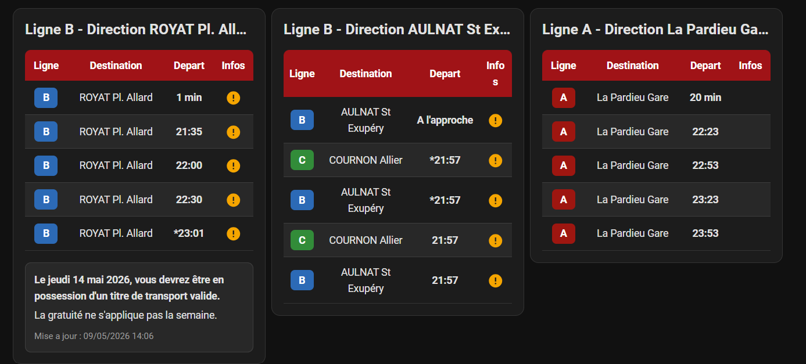

# T2C Clermont-Ferrand Card

Carte Lovelace pour Home Assistant permettant d'afficher les prochains passages exposés par l'integration `t2c_clermontferrand`.



## Fonctionnalites

- Selection de l'arret depuis l'editeur visuel Home Assistant.
- Affichage automatique des prochains passages a partir de l'entite `passage_1`.
- Nombre de passages réglable de 1 à 6 (5 par défaut).
- Pastilles de ligne colorees avec les attributs `route_color` et `route_text_color`.
- Colonne `Infos` vide par defaut, avec une icone d'alerte quand `has_alert` vaut `true`.
- Bloc de detail au clic ou au tap sur l'icone, compatible desktop et mobile.
- Horaires théoriques affichés sans astérisque ni légende.
- Petite icône verte à côté des départs en temps réel, avec l'infobulle « Temps réel ».
- Bloc optionnel pour afficher l'information generale du reseau.
- Compatible installation HACS en categorie `Dashboard`.

## Installation avec HACS

1. Dans HACS, ajouter ce depot comme depot personnalise.
2. Choisir la categorie `Dashboard`.
3. Installer `T2C Clermont-Ferrand Card`.
4. Verifier que la ressource est de type `Module JavaScript`.
5. Vider le cache du navigateur si la carte n'apparait pas tout de suite.

Ressource attendue :

```text
/hacsfiles/T2C-Clermont-Ferrand-Card/t2c_clermont-ferrand_card.js
```

Conserver la ressource créée par HACS et vérifier son chemin dans les paramètres du tableau de bord. Ne pas ajouter une deuxième ressource pour la même carte.

## Installation manuelle avec FileZilla

Le fichier à transférer est `dist/t2c_clermont-ferrand_card.js` dans ce dépôt. Les modifications locales ne sont pas automatiquement installées dans Home Assistant ni publiées sur GitHub.

Pour une installation qui conserve le sous-dossier `dist` :

1. Transférer le fichier vers `/config/www/community/t2c_clermontferrand_card/dist/t2c_clermont-ferrand_card.js`.
2. Ajouter ou modifier la ressource du tableau de bord avec le type **Module JavaScript** et cette URL :

   ```text
   /local/community/t2c_clermontferrand_card/dist/t2c_clermont-ferrand_card.js?v=0.2.9
   ```

3. Recharger complètement le tableau de bord avec **Ctrl + F5**.

Le chemin de la ressource doit correspondre exactement au dossier distant. Si le fichier est placé directement dans `t2c_clermontferrand_card`, retirer `/dist` de l'URL. Le suffixe `?v=0.2.9` permet de renouveler le cache ; il ne remplace pas le transfert du nouveau fichier.

Seul le fichier JavaScript est nécessaire pour cette carte. Il n'est pas nécessaire de transférer les dossiers `.git`, `.github`, `.agents` ou `docs`. Éviter de conserver plusieurs copies actives de la carte à des emplacements différents.

## Utilisation

Depuis l'editeur de dashboard Home Assistant :

1. Ajouter une nouvelle carte.
2. Choisir `T2C Clermont-Ferrand Card`.
3. Selectionner l'arret a afficher dans la liste.
4. Ajuster le titre, le nombre de passages et l'affichage de l'information reseau si besoin.

Configuration YAML minimale :

```yaml
type: custom:t2c-clermontferrand-card
entity: sensor.ligne_b_direction_royat_pl_allard_arret_les_chapelles_passage_1
```

Configuration complete :

```yaml
type: custom:t2c-clermontferrand-card
entity: sensor.ligne_b_direction_royat_pl_allard_arret_les_chapelles_passage_1
title: Les Chapelles
passages: 5
show_network_info: true
```

## Options

| Option | Obligatoire | Defaut | Description |
| --- | --- | --- | --- |
| `entity` | Oui |  | Entite `passage_1` de l'arret a afficher. |
| `title` | Non | Nom de l'entite | Titre affiche en haut de la carte. |
| `passages` | Non | `5` | Nombre de passages a afficher, entre 1 et 6. Les valeurs superieures sont limitees a 6, y compris en YAML. |
| `show_network_info` | Non | `false` | Affiche le bloc d'information generale du reseau si l'entite est detectee. |

## Convention d'entites

La carte se configure avec l'entite `passage_1` d'un arret. Elle reconstruit ensuite les autres passages avec le meme prefixe :

```text
sensor.ligne_X_direction_YYY_arret_ZZZ_passage_1
sensor.ligne_X_direction_YYY_arret_ZZZ_passage_2
sensor.ligne_X_direction_YYY_arret_ZZZ_passage_3
sensor.ligne_X_direction_YYY_arret_ZZZ_passage_4
sensor.ligne_X_direction_YYY_arret_ZZZ_passage_5
sensor.ligne_X_direction_YYY_arret_ZZZ_passage_6
```

Exemple :

```yaml
type: custom:t2c-clermontferrand-card
entity: sensor.ligne_b_direction_royat_pl_allard_arret_les_chapelles_passage_1
```

## Attributs de passage

Chaque capteur de passage peut contenir les attributs suivants :

```yaml
destination: ROYAT Pl. Allard
line: B
route_id: B
route_color: "#0069b4"
route_text_color: "#ffffff"
realtime: true
theoretical: false
estimated_at: "2026-10-15T22:26:33+02:00"
scheduled_at: "2026-10-15T22:23:00+02:00"
due_at: "2026-10-15T22:26:33+02:00"
has_alert: true
alert_icon: mdi:alert-circle
alert_title: J. Mermoz reportes
alert_text: En raison de travaux, les arrets J. Mermoz seront reportes.
updated_at: "2026-04-27T10:08:33"
```

L'état du capteur est utilisé comme horaire ou temps d'attente. Les astérisques sont retirés uniquement de l'affichage : `*23:23` devient `23:23`. Les données du capteur ne sont pas modifiées.

### Temps réel et horaires théoriques

| Attribut | Temps réel | Théorique |
| --- | --- | --- |
| `realtime` | `true` | `false` |
| `theoretical` | `false` | `true` |
| `estimated_at` | Estimation valide | `null` |
| `scheduled_at` | Horaire théorique | Horaire théorique |
| `due_at` | Estimation utilisée | Horaire théorique utilisé |

Un départ en temps réel porte une petite icône verte avec l'infobulle « Temps réel ». Un départ théorique affiche uniquement son horaire, sans astérisque, icône ni légende.

L'icône de temps réel apparaît lorsque `realtime` vaut `true`. Elle reste masquée si `theoretical` vaut `true`, si le départ contient `*` ou si le capteur est indisponible. Si `realtime` est absent, un `estimated_at` contenant une date valide permet aussi d'afficher l'icône. `scheduled_at` et `due_at` seuls ne permettent pas de distinguer un horaire théorique d'une estimation.

Les noms d'attributs sont lus de facon souple. Les variantes comme `Route ID`, `Route color`, `Route text color`, `Has alert`, `Alert icon`, `Alert title`, `Alert text` et `Updated at` sont prises en charge.

## Alertes

La colonne `Infos` reste vide quand il n'y a pas d'alerte.

Si `has_alert` vaut `true`, la carte affiche l'icone indiquee par `alert_icon`. Cliquer ou appuyer sur l'icone affiche un bloc de detail sous le tableau, compatible desktop et mobile :

```text
...
...
Mise a jour : ...
```

## Information reseau

L'option `show_network_info` affiche un bloc d'information generale du reseau sous le tableau.

La carte tente de detecter automatiquement une entite dont l'identifiant ou le nom contient :

```text
informations_reseau
network_info
Informations reseau
```

Les attributs reconnus pour ce bloc sont notamment :

```yaml
title: Information reseau
text: Le jeudi 14 mai 2026, vous devrez etre en possession d'un titre de transport valide.
updated_at: "2026-05-09T14:06:00"
```

Les variantes `info`, `message`, `description`, `Alert title`, `Alert text` et `Updated at` sont aussi prises en charge.

Si aucun attribut de texte n'est fourni, l'etat du capteur est utilise comme message, sauf pour les etats techniques comme `unknown` ou `unavailable`.

## Diagnostic

Si Home Assistant affiche `Custom element doesn't exist: t2c-clermontferrand-card`, ouvrir la console du navigateur sur le dashboard et executer :

```js
customElements.get("t2c-clermontferrand-card")
window.t2cClermontFerrandCardVersion
```

Le premier appel doit retourner une classe JavaScript et le second doit retourner la version chargee de la carte.

Pour le fichier actuel, la version attendue est `0.2.9`. La console affiche également `chargement 0.2.9` au chargement.

Si une ancienne version apparaît ou si l'icône de temps réel manque :

1. Vérifier que le fichier transféré provient bien du dossier `dist` du dépôt.
2. Vérifier que l'URL de la ressource pointe sur ce fichier distant, en tenant compte du sous-dossier `dist` et du nom exact du dossier.
3. Conserver une seule ressource pour cette carte et retirer les références aux anciennes copies.
4. Pour une installation manuelle, actualiser le suffixe de version dans l'URL puis recharger avec **Ctrl + F5**.
5. Si la bonne version est chargée, vérifier les attributs `realtime`, `theoretical` et `estimated_at` du capteur dans les outils de développement de Home Assistant.

Si les deux valeurs sont `undefined`, Home Assistant n'a pas encore charge la ressource. Verifier le chemin, le type `Module JavaScript`, puis vider le cache du navigateur.

## Publication de la version 0.2.9

Avant de créer la release, publier les fichiers à jour sur GitHub, notamment `README.md`, `hacs.json` et `dist/t2c_clermont-ferrand_card.js`.

- **Tag GitHub :** `v0.2.9`.
- **Titre de la release :** `v0.2.9 — Indicateur de temps réel et affichage simplifié`.
- **Fichier à joindre à la release :** `dist/t2c_clermont-ferrand_card.js`, sous le nom `t2c_clermont-ferrand_card.js`.
- **Manifeste HACS :** `hacs.json`, à conserver à la racine du dépôt.

Cette carte est un module de tableau de bord, pas une intégration Home Assistant : elle n'utilise pas de fichier `manifest.json`. Le numéro de version figure dans le fichier JavaScript et dans le tag de release ; aucun champ `version` n'est nécessaire dans `hacs.json`.

### Nouveautés

- Icône verte pour les départs en temps réel, inspirée de celle du réseau T2C.
- Horaires théoriques affichés sans astérisque ni légende.
- Nombre de passages limité à 6 dans l'éditeur et dans l'affichage, y compris avec une configuration YAML.
- Documentation des attributs de temps réel, de l'installation manuelle et du diagnostic de cache.

## Licence

Ce projet est distribue sous licence MIT. Voir [LICENSE](LICENSE).
